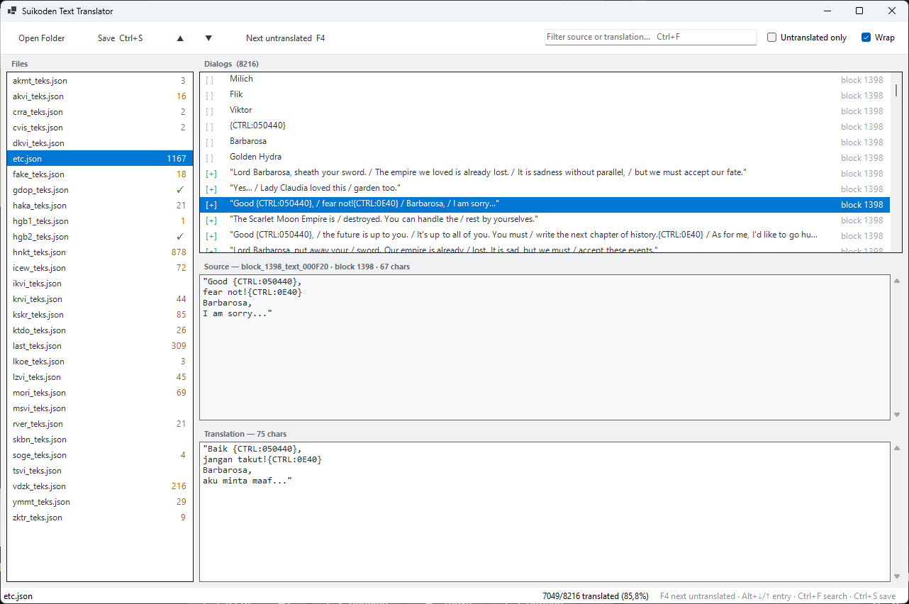

# SuikodenText

Tool untuk membaca, mengedit, dan menulis ulang teks game Suikoden III
(PlayStation 2). Teks di dalam archive `.bin` diekspor ke JSON, diedit 
atau diterjemahkan, lalu diimpor balik menjadi file game yang bisa 
langsung dipakai.

Repo tidak menyertakan data game. Butuh file disc sendiri: folder archive
`.bin`, `fsect.bin`, dan executable `SLUS_203.87`.

## Proyek

| Proyek | Output | Fungsi |
|---|---|---|
| `SuikodenText.Cli` | `SuikodenText.exe` | CLI: scan, export, import, per file atau per folder |
| `SuikodenText.Desktop` | `SuikodenText.Desktop.exe` | GUI export/import lewat dialog file |
| `SuikodenText.Translator` | `SuikodenText.Translator.exe` | GUI editor terjemahan untuk JSON hasil export |
| `SuikodenText.Core` | library | Codec teks, reader/writer archive, FSECT, patch pointer ELF |
| `SuikodenText.Tests` | console | Test suite (fixture + encode/decode 20.502 entri referensi) |

`SuikodenText.Core` dipakai ketiga aplikasi. Tidak ada dependensi NuGet pihak
ketiga.

## Persyaratan

- Build dari source: SDK .NET 8.
- Menjalankan exe hasil Release: **.NET 8 Desktop Runtime x64** (sudah
  mencakup runtime untuk CLI dan GUI). Exe hasil publish framework-dependent:
  satu file, tanpa DLL pendamping, tanpa ZIP.
- GUI WinForms berjalan di Windows. CLI berbasis `net8.0`; di Linux/macOS
  jalankan dengan `dotnet SuikodenText.dll`.

## CLI

```
SuikodenText scan          archive.bin [fsect.bin] [--exe SLUS_203.87]
SuikodenText export        archive.bin [fsect.bin] text.json [--exe SLUS_203.87]
SuikodenText import        archive.bin [fsect.bin] text.json output [--exe SLUS_203.87]
SuikodenText export-folder DATA [DATA/fsect.bin] translations [--exe SLUS_203.87]
SuikodenText import-folder DATA [DATA/fsect.bin] translations output [--exe SLUS_203.87]
```

`import` punya alias `build`. `scan` hanya menampilkan ringkasan di terminal.

Aturan pemakaian:

- `etc.bin` (ETC) membutuhkan `--exe SLUS_203.87` dan **tanpa** FSECT. Archive
  lain membutuhkan `fsect.bin` dan tanpa `--exe`.
- Mode folder: nama JSON menentukan archive yang diproses — `krvi_teks.json`
  cocok dengan `krvi.bin`, `etc.json` dengan `etc.bin`. Jangan mengganti nama
  file JSON tersebut.
- Folder import hanya memproses archive yang JSON-nya ada di folder terjemahan.
- FSECT bisa juga diberikan lewat `--fsect PATH`.

Alur khas untuk menerjemahkan seluruh game:

```powershell
.\SuikodenText.exe export-folder DATA DATA/fsect.bin teks --exe SLUS_203.87
# edit field "translation" di folder teks/
.\SuikodenText.exe import-folder DATA DATA/fsect.bin teks hasil --exe SLUS_203.87
```

Import menghasilkan archive game baru, `FSECT.BIN` final, dan executable yang
sudah diperbarui (jika `--exe` diberikan). Kalau ada kegagalan, folder hasil
tidak diterbitkan.

## GUI Desktop

`SuikodenText.Desktop.exe` memuat operasi yang sama lewat dialog. Dropdown
memilih mode **SingleFile** atau **Folder**:

- **Export**: pilih archive BIN (folder mode: pilih folder BIN) + FSECT, atau
  EXE untuk ETC → simpan JSON.
- **Import**: pilih JSON + archive BIN + FSECT/EXE → pilih folder output.
  Folder mode: pilih folder JSON + folder BIN.

`etc.bin` / `etc.json` terdeteksi dari nama file; aplikasi otomatis meminta
EXE dan tidak meminta FSECT untuk archive itu.

## GUI Translator

`SuikodenText.Translator.exe` membuka folder JSON hasil export. Layout: daftar
file di sidebar, daftar entri di sebelahnya, editor Source dan Translation
berdampingan.



- `Ctrl+F` filter source/translation, checkbox **Untranslated only** menyaring
  entri yang belum diterjemahkan.
- Checkbox **Wrap** membungkus baris pada 34 karakter (batas tampil font game).
  `F4` melompat ke entri belum diterjemahkan berikutnya, `Ctrl+S` menyimpan.
- Perhitungan "untranslated" = `translation` sama dengan `source`. Nama tokoh
  dan tempat memang sengaja dibiarkan Inggris, jadi angka ini tidak akan
  pernah nol.
- Yang ditulis ke JSON hanya field `translation`. `index`, `id`, `source`, dan
  semua token tidak diubah.

## Format JSON

```json
{
  "blocks": [
    {
      "index": 0,
      "entries": [
        {
          "id": "block_0000_text_0005A0",
          "source": "Hello!",
          "translation": "Halo!"
        }
      ]
    }
  ]
}
```

Informasi yang dibutuhkan untuk membangun ulang blok
dibaca dari archive sumber saat import — JSON tidak menyimpan alamat RAM,
ukuran, atau hash.

## Batasan teks

Validasi dijalankan saat import; teks yang melanggar ditolak, bukan
dibiarkan merusak file game.

- Karakter harus ASCII printable (32–126) plus `\n`. `{` dan `@` tidak boleh
  di bagian tertentu.
- Token `{CTRL:...}`, `{RAW:...}`, dan urutan placeholder printf harus
  dipertahankan persis.
- Slot teks di executable punya batas byte ketat (dibaca dari ELF). Kelebihan
  kapasitas ditolak.
- Batas RAM per blok: event 256 KiB, event HNKT tertentu 240 KiB, bank dialog
  HNKT 16 KiB. Alokasi RAM game tidak diperbesar.
- Teks panjang direlokasi otomatis dan pointer/indeks ELF diperbarui. Jika
  celah zero di PT_LOAD utama habis, import menambah segmen PT_LOAD baru
  (512 KiB, alamat 0x01A30000) dengan program header kedua.
- Teks executable mencakup tabel UI, inventory, database item/skill/menu,
  nama lokasi, dialog town/shop, nama senjata forge, rune, mantra, biografi
  karakter, dan 100 slot nama tetap — total 2.870 entri untuk SLUS_203.87.
- Teks tertanam di dalam kode MIPS (termasuk petunjuk minigame ETC
  block_1052) belum didukung.

## Build dan test

```powershell
dotnet build SuikodenText.sln -c Release
dotnet run --project src/SuikodenText.Tests -c Release
```

Test suite memakai fixture internal. Untuk menguji dengan file game asli dan
kompatibilitas JSON lama, tambahkan folder DATA dan folder JSON referensi
setelah `--`:

```powershell
dotnet run --project src/SuikodenText.Tests -c Release -- DATA referensi-json/
```
